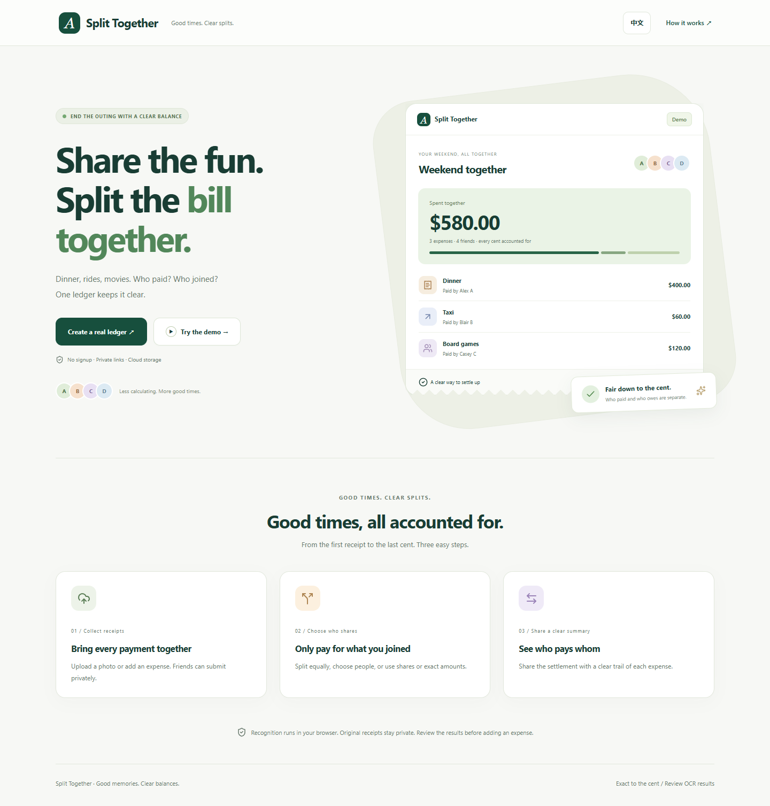

# Split Together

**Split the bill. Keep the good times.**

## Use it online

### [Open Split Together →](https://yiqi-a-split-mate-1028.suguyy.chatgpt.site/)

**Ready to use in your browser. No installation, deployment, or account required.**

1. Open the website and create a ledger, or try the example first.
2. Add expenses or collect receipt photos from your friends.
3. Review everyone’s share and share the settlement summary.

Works on your phone, tablet, or computer. You can switch between English and Chinese.

Dinner is over. One friend paid for food, another covered the ride, and the receipts are scattered across everyone’s phones. Working out who owes what shouldn’t become the last activity of the night.

Split Together brings those expenses into one shared ledger, so everyone can see their share and how to settle up.



## A little less awkward

- **Collect receipts together.** Each friend gets a private upload link. The organizer reviews the receipts before they count toward the bill.
- **Split what people actually shared.** Divide a whole expense or individual items equally, by shares, or by exact amounts. Multiple people can pay upfront.
- **See who owes whom.** Clear balances and suggested payments, with actual repayments recorded separately.
- **Take the summary with you.** Copy it into a group chat, save an image, or export CSV and JSON.

The interface works in English and Chinese, on a phone or a larger screen. Each ledger uses one currency: USD, CNY, HKD, or EUR.

## Why I built it

I wanted a small tool for a familiar problem: friends pay for different things, but a simple equal split rarely tells the whole story. The interesting part was keeping the experience easy while making the numbers traceable.

Amounts are stored as integer cents. Receipt recognition runs in the browser, and its results always need a human check. Admin, receipt-upload, and read-only links have separate access rights. Anyone holding a link has its permissions, so keep the admin link private.

## A few boundaries

This is a personal project, not a payment service. It suggests how to settle up; it doesn’t move money or convert currencies. Receipt recognition can make mistakes, especially with unclear photos. Review the amounts before saving.

Third-party libraries and bundled OCR resources keep their own licenses. See [third-party notices](THIRD_PARTY_NOTICES.md).

## For developers

The hosted website above is the easiest way to use Split Together. Local setup is optional, for exploring or changing the code.

<details>
<summary>Optional: run the source code locally</summary>


You’ll need Node.js 22.13+ and npm.

```sh
npm ci
npm run setup:ocr
npm run db:local
npm run dev
```

Open the local address printed in the terminal. Local development uses an emulated database and receipt storage; no production account or API key is needed.

```sh
npm test
npm run typecheck
npm run build
```

Built with React, TypeScript, Vinext, Cloudflare Workers, D1, R2, and Tesseract.js. See [development notes](docs/development.md) for browser checks and hosting.

</details>
